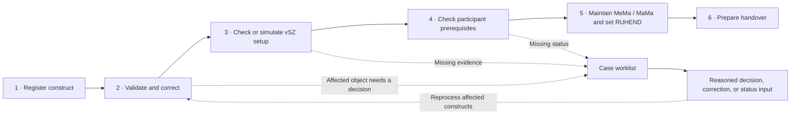
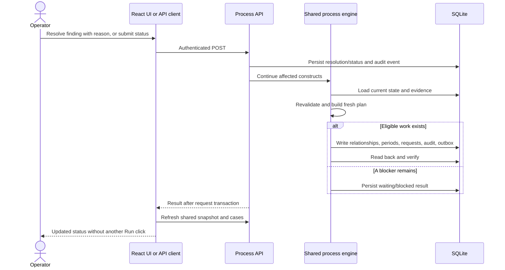
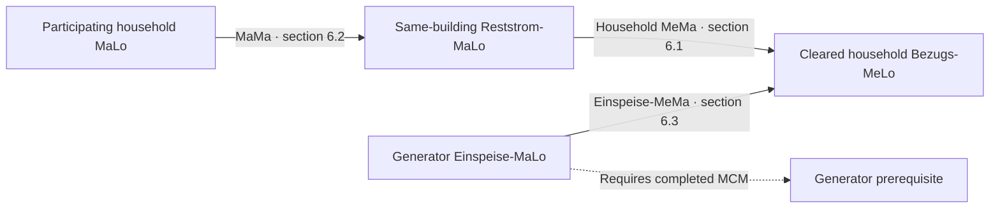
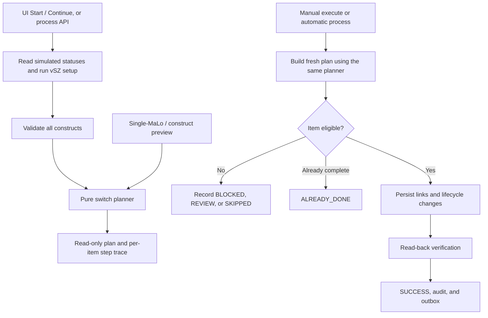
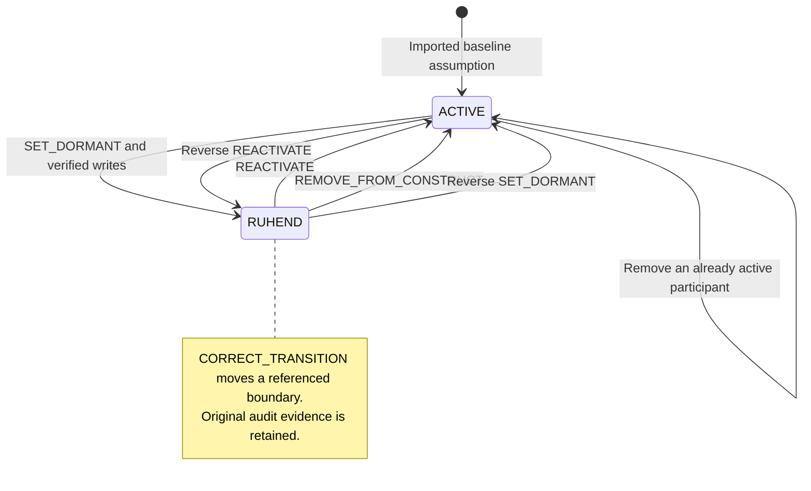
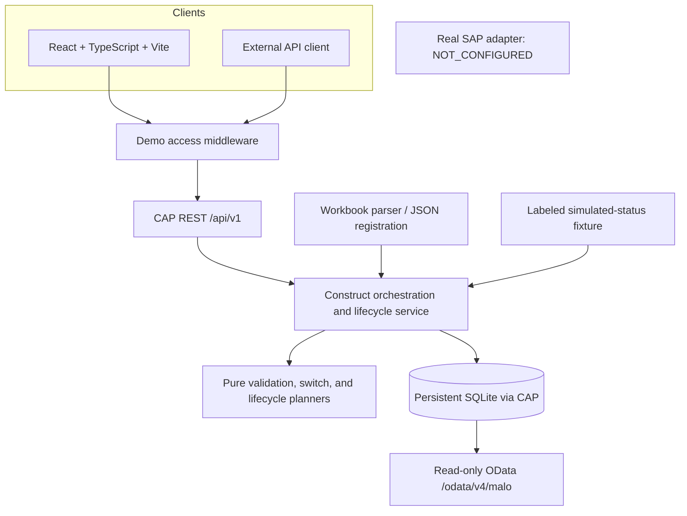
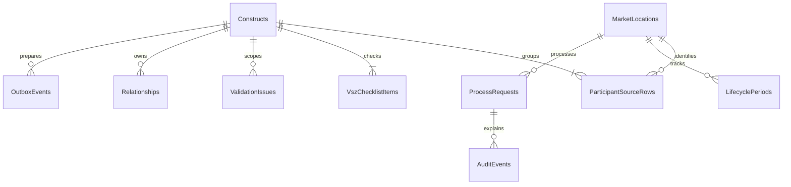
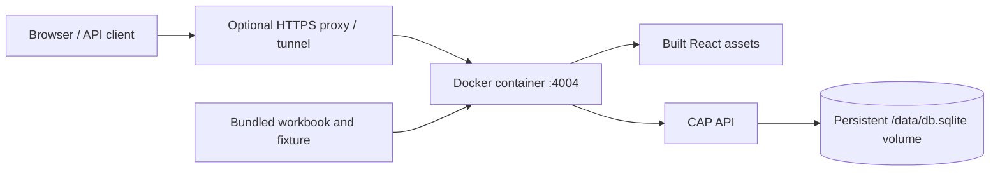

# Ruhend · MK7 Control Center

## How the whole application works

**Business process, user experience, system logic, and implementation**  
Current implementation · 16 October 2026 · Application version `0.1.0` · API `v1`

> **SIMULATION — NO SAP CONNECTION**  
> The application runs real validation, API calls, transactions, and persistence in SQLite. SAP setup, market statuses, and MaLo transitions are simulated. Downstream messages are recorded locally; none are sent.

**Reading path:** 01–05 explain the product; 06–10 explain its decisions; 11–15 explain its implementation; 16 provides a demonstration. The appendices provide the complete rule and API inventory.

---

## 01 · Purpose and business vocabulary

**Ruhend coordinates the conversion of participating household market locations into dormant MaLos within an MK7 construct.** It imports participants, detects problems, collects decisions, maintains relationships, records lifecycle changes, and prepares handover evidence.

| Term | Meaning in this application |
| --- | --- |
| **MK7 construct** | One building and its residual-supply location, households, and generators. |
| **MaLo** · Marktlokation | A market location with a global string identifier. Household MaLos are dormancy candidates. |
| **MeLo** · Messlokation | A metering location. One MaLo may have several MeLos. |
| **Reststrom-MaLo** | The building's residual grid-supply anchor; never a household dormancy target. |
| **vSZ** · virtueller Summenzähler | Virtual summation-meter setup, represented by ten readiness/checklist items. |
| **MeMa / MaMa** | Metering-to-market / market-to-market relationships; directions are explained in section 07. |
| **Stichtag / Zeitscheibe** | Effective date / validity interval for a relationship or lifecycle state. |
| **Abmeldung / MCM** | Supplier deregistration / prerequisite process completion for generator relationships. |

The intended audience is an operator handling constructs, a reviewer resolving exceptions, or another service using the same process API.

---

## 02 · The complete process at a glance



| Stage | Automatic behavior | Human involvement |
| --- | --- | --- |
| **1 · Anmeldung** | Normalize rows; derive one construct per building and its Reststrom target. | Upload workbook or register JSON. |
| **2 · Prüfung & Korrektur** | Apply V01–V14; attach each finding to the objects it blocks. | Choose assignment, correct data, exclude, or confirm an assumption with a reason. |
| **3 · Aufbau vSZ** | Evaluate ten steps; store simulated setup outcomes and evidence. | Confirm unresolved checklist items with evidence. |
| **4 · Voraussetzungen** | Require iMSys and supplier deregistration for households; MCM for generators. | Submit status input or a documented manual confirmation. |
| **5 · Umstellung** | Build a fresh plan; write relationships and RUHEND periods; verify persisted results. | Start processing, or preview and execute through the API. |
| **6 · Übergabe** | Make the relationship list available; record deduplicated outbox events. | Download CSV or consume JSON. |

**Scope of a blocker:** a participant finding holds that participant; a construct finding holds that construct. Other eligible items continue. Technical storage failures roll back the entire API request.

---

## 03 · Inputs, data lineage, and baseline

Only **`MK7 Teilnehmer`** from `data/source/Datensatz_Deutsch.xlsx` supplies the participant master list. Hourly consumption, generation, pricing, and payment sheets are outside the implemented process.

| Baseline measure | Count | Interpretation |
| --- | ---: | --- |
| Constructs / buildings | **3** | Frankfurt, Köln, and Mülheim. |
| Source assignments | **17** | 3 Reststrom + 3 generators + 11 household rows. |
| Global MaLo identities | **16** | One MaLo occurs in two buildings. |
| Participating household rows | **10** | **9 unique** participating household MaLos. |
| Nonparticipating household | **1** | `50539603604`; stays ACTIVE and receives no dormancy relationships. |
| Participant case rows | **14** | Household and generator rows; Reststrom anchors have no case. |

| Building | Derived Reststrom-MaLo |
| --- | --- |
| `B-FRA-01` | `51781215544` |
| `B-CGN-01` | `51781215999` |
| `B-MUL-01` | `50539603639` |

**Normalization:** IDs stay strings; original row identity, raw cell data, file name, and checksum preserve lineage. Dates become `YYYY-MM-DD`; Excel serial `46296` becomes `2026-10-01`. The original workbook is unchanged.

**Evidence boundaries:** household ACTIVE is a baseline assumption. The initial Stichtag is the earliest participating household supply date, a demo default. Supplier, MCM, and DSO-DP statuses come from the labeled simulation fixture. For known baseline constructs, workbook `messsystem` values are read during processing; fixture fallback values can also supply iMSys status. This is source evidence, never live SAP verification.

---

## 04 · Screens and navigation

| Surface | What the user sees and can do |
| --- | --- |
| **Overview** · `/` | Live KPIs, unique household completion, one construct card per building, six-stage progress, open cases, **Start process**, and process explanation. |
| **Construct** · `/constructs/{id}` | PDF-aligned timeline, vSZ evidence, prerequisites, MeMa/MaMa lists, participant groups, recent history, **Continue**, and CSV export. |
| **Cases** · `/cases` | Open work grouped by decision, correction, status, or vSZ readiness; category filters and direct case access. |
| **Case drawer** · opens across screens | Explanation, per-step trace, relevant findings, assignment comparison, status input, validated corrections, master data, relationships, periods, lifecycle operations, and history. |
| **Process explained** · `/process` | In-app explanation of all six stages. |
| **API console** · `/api-console` | Endpoint catalogue, editable requests, live responses, timings, curl examples, measured before/after effects, and OpenAPI download. |
| **API access** · `/api-console/access` | Create keys, show each secret once, inspect usage, and revoke keys. |
| **Activity** · `/activity` | Combined business/API history; filters for construct, action, source, and search text. |
| **User menu** | Sign out, run self-check scenarios, import workbook, and reset the demo. Administrative controls require Maintainer access. |

**Shared experience:** German/English switch, preserved market terms, simulation marker, responsive layout, loading/error/empty feedback, keyboard-accessible component primitives, and reduced-motion support.

---

## 05 · What happens in a baseline demonstration

| Moment | Household result | Remaining work |
| --- | --- | --- |
| After import/reset | Household MaLos ACTIVE; no process relationships or outbox events. | Participating cases NEW; checklist/status inputs initially UNKNOWN. |
| First **Start process** | **6 unique household MaLos become RUHEND.** | One ambiguous MaLo, two pending supplier deregistrations, plus generator findings. |
| Resolve household findings | **9 of 9 unique participating households RUHEND.** | Generator issues can still require correction/confirmation. |
| Correct wind MeLo and confirm shared feed-in assignment | Complete baseline: **9 household MeMa + 9 MaMa + 9 Einspeise-MeMa**. | No open action cases in the tested completion path. |
| Repeat processing | Completed items return `ALREADY_DONE`. | No duplicate dormancy transitions or relationship creation. |

The full baseline also records **3 EDM**, **3 UTILMD**, and **9 INVOIC** handover events, all with `NOT_IMPLEMENTED` delivery status.

**Important counting distinction:** run `success` totals can include generator relationship work. The Overview household KPI counts unique household MaLos. A case count is a count of assignments/work items, not necessarily unique MaLos.

---

## 06 · Validation and the human decision loop

The pure rule engine validates **all constructs together**, allowing it to detect cross-building identities and shared generator assignments. Findings carry a stable fingerprint, rule, severity, affected objects, and permitted resolutions.

| Actual baseline finding | Effect | Resolution |
| --- | --- | --- |
| `50539603888` occurs in Frankfurt and Köln · **V05** | That global MaLo waits in REVIEW. | Choose the correct building with a reason; retain the other row as excluded. |
| `50539603876`, `50539603103` · **V11** | Household waits for supplier Abmeldung. | Submit `abmeldung=CONFIRMED`, or confirm manually with a reason. |
| Wind MeLo has 34 characters · **V02** | That generator's relationships are blocked. | Correct to a valid 33-character ID, or exclude the row. |
| Feed-in MaLo `51664053767` spans three constructs · **V14** | Generator relationships require review. | Confirm the shared assignment with a reason, or exclude affected participation. |
| Workbook MaLo check digits · **V03** | Informational notices for synthetic IDs. | No override needed; these notices do not block this demo. |



Finding resolutions are `CHOOSE_BUILDING`, `EXCLUDE_PARTICIPANT`, `FIX_VALUE`, and `CONFIRM_ASSUMPTION`. Each requires a reason. Revalidation closes findings that no longer apply as `AUTO_CLEARED` and preserves explicit acknowledgements.

---

## 07 · The central relationship logic



| Relationship | Direction and condition |
| --- | --- |
| **Household MeMa** | Reststrom-MaLo → every participating, cleared household MeLo in the same construct. |
| **MaMa** | Each cleared household MaLo → that construct's Reststrom-MaLo. |
| **Einspeise-MeMa** | Generator feed-in MaLo → cleared household MeLos; only after MCM and generator findings are resolved. **No generator MaMa or household dormancy transition.** |

The planner derives required links from current participant data, compares them with persisted `SIMULATED` relationships, and labels them **`TO_CREATE`**, **`EXISTS`**, or, after execution, **`CREATED`**. A conflicting open MaMa target blocks that household. Missing links are explicit planned writes.

**Current implementation:** this is plan-versus-local-state comparison. There is no live SAP-observed relationship set or separate current four-way reconciliation report.

**Time convention:** intervals are half-open **`[validFrom, validToExclusive)`**. `null` is open-ended; relationship export presents the open end as `9999-12-31` with `open=true`.

---

## 08 · Aufbau vSZ: the ten-step gate

The pipeline stores a checklist outcome and evidence for each setup step. Simulated SAP setup parameters are recorded as evidence; dedicated real SAP installation/device objects are not created.

| PDF step | Checklist item | Current behavior |
| --- | --- | --- |
| **1** | Measuring concepts / DSO-DP | Known fixture construct → simulated confirmation; otherwise UNKNOWN. |
| **2** | Steckbriefe / participant lists | Check available rows, household counts, and operator information. |
| **3** | iMSys installation | Count installed/confirmed household iMSys statuses; return CHECKED, PARTIAL, or MISSING. |
| **4.1** | Reststrom-MaLo and Anlage | Check exactly one residual-supply identity; record simulated setup. |
| **4.2** | Geräteinfosatz | Record simulated device/billing-installation evidence. |
| **4.3** | Zählpunktart | Record simulated market-location/VBZS setup evidence. |
| **4.4** | Lastprofil | Record simulated profile assignment from the Stichtag. |
| **4.5** | ZP-Status | Record simulated commissioning-date setup; separate from dormancy. |
| **4.6** | Bilanzierung | Record simulated settlement-data evidence. |
| **4.7** | BIKO / MSB services | Record simulated service-maintenance evidence. |

Passing checklist statuses are `DONE`, `CHECKED`, `PARTIAL`, and `CONFIRMED`. **PARTIAL iMSys readiness still requires each household to pass V10.** UNKNOWN/MISSING items hold the construct. A person's confirmation with evidence is preserved on later runs.

---

## 09 · Manual execution, automatic execution, and repeat safety



- **Preview** does not alter business state, relationships, or domain audit. Its authenticated HTTP call can still appear in the API call log.
- **Execute** reloads state and revalidates; it does not trust a previously displayed preview.
- **Shared logic:** manual dormancy and automatic processing use `executeSwitch`; lifecycle preview/execution share `buildLifecyclePlan`.
- **Idempotency:** household key is `SET_DORMANT|MaLo|construct|Stichtag`; blocked requests are retried on the same record, successful requests are never downgraded. Outbox events have separate deduplication keys.
- **Execution model:** constructs are processed sequentially within the calling CAP transaction. Business blockers are isolated by object; a technical failure rolls back the request.
- **Triggers:** workbook import/reset waits for Start; JSON registration, issue resolution, vSZ confirmation, and status input immediately continue affected constructs. `setStichtag` revalidates; processing follows a later process call.
- **No scheduler:** future effective dates are stored as modeled intervals during execution. The MaLo's summary state updates immediately; there is no timed activation job.

---

## 10 · Complete MaLo lifecycle



| Operation | Effect and safeguards |
| --- | --- |
| **Ruhendstellung** · `SET_DORMANT` | Require eligible ACTIVE household; maintain MeMa/MaMa; close ACTIVE period and open RUHEND from construct Stichtag. |
| **Wiederaktivierung** · `REACTIVATE` | After dormant start, close RUHEND and open ACTIVE. Keep relationships as a documented demo assumption. Automatic processing does not make it dormant again. |
| **Herauslösung** · `REMOVE_FROM_CONSTRUCT` | Close applicable open MaMa, household MeMa, and Einspeise-MeMa to its MeLos; exclude the participant. A dormant MaLo returns to ACTIVE. The UI requires a reason. |
| **Korrektur** · `CORRECT_TRANSITION` | Require successful reference and reason; move an existing transition boundary and matching relationship starts without creating invalid periods. Retain original request/audit evidence. |
| **Rücknahme** · `REVERSE_TRANSITION` | Require successful reference, reason, and a later effective date; append a compensating transition. Reject duplicate reversals; keep original history. |

The case drawer exposes the four post-dormancy operations with **Check → confirmation → Execute**. Single-MaLo dormancy is also available through `/preview` and `/execute`; its date must match the construct Stichtag.

**Status domains stay separate:** MaLo state = `ACTIVE/RUHEND/UNKNOWN`; item result = `READY/SUCCESS/SKIPPED/ALREADY_DONE/BLOCKED/REVIEW/ERROR`; case workflow = `NEW/DONE/READY/WAITING/DECISION/CORRECTION/EXCLUDED/NOT_PARTICIPATING/REACTIVATED`.

---

## 11 · Technical architecture and live UI data



| Layer | Actual implementation |
| --- | --- |
| **UI** | React 19, TypeScript, Vite 8; Tailwind CSS v4, shadcn/ui/Radix, Lucide, Source Sans 3 and IBM Plex Mono. |
| **Client state** | Typed REST client and shared React context. Clean URLs use the History API; older hash links are normalized. |
| **Refresh** | Initial/manual refresh, four-second polling while visible, and refresh on focus/visibility return. Unchanged snapshots avoid redraws. |
| **Snapshot** | Loads constructs, cases, checklist, simulated relationships, requests, audit, outbox, and API calls concurrently. |
| **Backend** | SAP CAP Node.js/TypeScript modular monolith; REST transport → orchestration → pure planners → CAP persistence. |
| **Storage** | CDS schema with `@cap-js/sqlite`; on-disk `db.sqlite` is authoritative. Browser refresh retains business changes. |
| **Import** | `xlsx` parser; shared registration path for workbook and JSON. |
| **Integration boundary** | Real SAP adapter throws `NOT_CONFIGURED`; the running process uses local simulated status and persistence. |

**UI limits:** snapshots request the latest 500 process requests, 200 audit events, and 100 API calls. The activity popover shows up to 30 combined entries. Older records remain queryable through the API. Overview stage animation reveals the completed server result; it is not streamed backend progress.

---

## 12 · Data model and traceability

The diagram shows **logical relationships by stored IDs**, not CDS foreign-key associations.



| Entity / group | Stored responsibility |
| --- | --- |
| `Constructs`, `Buildings` | Building metadata, Reststrom target, Stichtag, stage, and recomputed counters. |
| `ParticipantSourceRows` | Original assignment identity/raw cells plus normalized IDs, participation, exclusion, and prerequisite statuses. Duplicate assignments stay visible. |
| `MarketLocations` | One global identity per MaLo, summary business state, assignment counts, and conflict metadata. |
| `ValidationIssues` | Fingerprinted findings, scope, permitted actions, resolution, reason, actor, and timestamps. |
| `VszChecklistItems` | Ten setup outcomes per construct, evidence, confirmation source, and time. |
| `Relationships`, `LifecyclePeriods` | Simulated links and dated ACTIVE/RUHEND periods, with provenance. |
| `ProcessRequests`, `ProcessRuns` | Per-item execution/idempotency/trace and aggregate `processAll` run summaries. Automatic continuations do not create separate ProcessRuns rows. |
| `AuditEvents` | Domain events with actors, reasons, references, effective dates, UTC timestamps, and before/after payloads where supplied. |
| `OutboxEvents` | Deduplicated downstream handover records; delivery remains `NOT_IMPLEMENTED`. |
| `ImportRuns` | Import source/checksum, counts, outcome, and timing. |
| `ApiKeys`, `ApiCalls` | Key metadata/hash/revocation and admitted non-login POST call activity. |
| `MeteringLocations`, `PrerequisiteChecks`, `SystemStatuses` | Additional schema entities; current registration/process behavior primarily uses source-row MeLos/statuses and request traces. These are not separate active UI workflows. |

Audit records are appended during normal operation. **Reset is an intentional exception:** it clears demo audit/history, keys, and call records, then writes fresh baseline registration evidence. The reset call itself can subsequently appear in activity.

---

## 13 · API access and attribution

The browser uses the same **`/api/v1` REST/JSON API** offered to other services. Read resources are projections; state changes use explicit POST actions. `/odata/v4/malo` is an additional internal read-only view.

| Caller | Reads | Previews | Process/lifecycle/status writes | Reset, upload, self-check, key management |
| --- | --- | --- | --- | --- |
| Anonymous | Yes | No | No | No |
| `VIEWER` key | Yes | Yes | No | No |
| `PIPELINE` key | Yes | Yes | Yes | No |
| `MAINTAINER` session/key | Yes | Yes | Yes | Yes |

**Current sign-in:** one fixed persona, **M. Weber**, with Maintainer permissions. Sessions are HMAC-signed, valid for 12 hours, and stored in browser `sessionStorage`. Sign-out clears the browser token. This is demo access control; there is no identity provider or individual password system.

**Service access:** Bearer API keys support all three roles. A secret is returned once; SQLite stores its SHA-256 hash and metadata. Revocation takes effect on subsequent calls. Middleware removes client-supplied identity headers and derives the audit actor from the authenticated principal; a body `actor` cannot impersonate another person.

**Optional public-demo gate:** `RUHEND_ACCESS_CODE` requires a shared code at sign-in; eight failed attempts per client address within five minutes trigger rate limiting. Reads remain public. Admitted non-login POST calls are logged with actor, route, status, and duration; access-denied attempts return before that logging hook.

**Errors:** 400 invalid input · 401 missing/invalid access · 403 insufficient role · 404 unknown object · 409 state conflict · 422 rule violation · 429 login throttling · 500 unexpected failure. A valid request may return HTTP 200 with a business outcome such as `BLOCKED`; clients must inspect both HTTP status and result code.

---

## 14 · Handover, import, and operational behavior

| Capability | Implemented behavior |
| --- | --- |
| **Relationship export** | Construct CSV download and `relationshipList()` JSON: kind, context, endpoints, validity, open-end indicator/provenance as applicable. Exact downstream billing template remains unconfirmed. |
| **EDM event** | One `EDM_ANPASSUNG` per construct after setup/construct gates permit switching, even if individual participants still wait. |
| **UTILMD event** | One `UTILMD_EINZUG_RESTSTROM_LIEFERANT` after that construct's first successful household dormancy. |
| **INVOIC event** | One `INVOIC_SCHLUSSRECHNUNG` per household dormancy/effective date. |
| **Delivery** | Local outbox records only; no dispatcher, market communication, billing, or EDM integration. |
| **JSON re-registration** | Replaces that building's rows/setup/relationships and resets affected simulation state; retains audit. It immediately reprocesses the construct. |
| **Workbook upload** | Base64 XLSX; validates sheet/headers, replaces all constructs/process state, then validates. Waits for Start. Existing domain audit is retained. |
| **CLI import** | Deploys the schema and re-registers the baseline; use as initialization/reinitialization, not incremental synchronization. |
| **Demo reset** | Requires UI confirmation and `{ "confirm": true }`; restores workbook baseline, clears process/history/outbox and keys, and waits for Start. Source Excel remains unchanged. |

Re-import does not create duplicate baseline identities, but **it resets simulation progress**. Preserve any history needed before reinitializing.

---

## 15 · Running, deployment, and verification

From the `ruhende-malo` directory, with Node.js 22+:

```bash
npm install
npm run import:data        # Initialize/reinitialize the simulation database
npm run dev                # CAP :4004 and Vite :5173
```

Vite proxies `/api` and `/odata` to CAP. The development script stops stale project-local servers first and uses `cds serve` to preserve history during presentation. Vite requires port 5173 rather than silently selecting another port.



**Deployment files provided:** multi-stage Node 24 Docker image, Compose service, health check, persistent volume, and amd64/arm64 image-publishing script. The same process serves built UI and API on port 4004. A schema hash change reinitializes the simulation database; an unchanged schema reuses it. Docker/NAS/cloud deployment was not executed for this document.

**Configuration:** `RUHEND_ACCESS_CODE` controls demo sign-in; `RUHEND_SESSION_SECRET` signs sessions; `RUHEND_PUBLIC_URL` sets displayed API examples; `PORT`, `DB_FILE`, and `UI_DIR` configure runtime paths. Container HTML includes security headers and versioned assets receive long-lived caching.

| Verification path | What it verifies |
| --- | --- |
| **`npm test` · executed 16 October 2026** | **79 tests passed across 7 files.** Real workbook import, pure rules/switch plans, lifecycle, translations, architecture, access controls, and HTTP end-to-end flows. |
| **`runSelfCheck` / user menu** | Executes 18 domain scenarios against isolated in-memory state plus a read-only workbook check; reports actual expected/actual results. Covered by the passing CLI suite. |
| **HTTP integration tests** | Start a real CAP server on port 4455 using a temporary database copy; presentation database remains unchanged. |
| **Other developer commands** | `npm run typecheck`, `npm run build`, `npm run api:spec`, `npm run stop:local`; available scripts, not rerun for this documentation change. |

**Remaining boundaries:** no real SAP connection/verified state, production identity integration, unattended scheduler, message delivery, settlement/billing/allocation engine, or proven production deployment. SAP's actual dormant-state update mechanism and final billing export contract remain external integration work.

---

## 16 · Presenter walkthrough

| Step | Show | Explain |
| --- | --- | --- |
| **1** | Sign in as M. Weber; reset from the user menu. | One simulation baseline, three constructs, nine unique household targets. Reset also removes API keys. |
| **2** | Overview → **Start process**. | Six households finish immediately; individual blockers leave valid work running. |
| **3** | Open `B-MUL-01`, then MaLo `50539603921`. | Ten vSZ items, household MeMa/MaMa, RUHEND period, verified request, and audit evidence. |
| **4** | Refresh the browser. | State persists in SQLite. |
| **5** | Cases: resolve pending Abmeldung statuses and choose Köln for `50539603888`. | Every action updates evidence and automatically continues affected constructs. Nine households become RUHEND. |
| **6** | Correct the wind MeLo; confirm shared feed-in assignment with a reason. | Generator path creates MeMa only; complete baseline has 27 relationships. |
| **7** | Download relationship CSV; inspect handover events. | Exports are usable local artifacts; UTILMD/INVOIC/EDM records are not delivered. |
| **8** | Case drawer → reactivate on a later date → Check → Execute. | History gains an ACTIVE period; earlier RUHEND evidence remains. |
| **9** | Switch DE/EN; open API, run a preview, then show access and activity. | UI and services share one backend; requests, roles, and actors are visible. |
| **10** | User menu → run self-check scenarios. | Real scenario assertions are distinct from the broader Vitest suite. |

---

## Appendix A · Complete validation inventory

Severity and blocking scope can vary by finding; **`affects` determines which object waits**, including prerequisite findings marked INFO/WARNING.

| Rule | Check | Scope / handling |
| --- | --- | --- |
| **V01** | Required role, MaLo, and MeLo | Affected object; correct or exclude. Import/registration also rejects missing required fields. |
| **V02** | MaLo: 11 digits, nonzero first digit; MeLo: `DE` + 31 uppercase alphanumeric characters | Affected household/generator, or construct for its anchor; correct or exclude. |
| **V03** | Implemented MaLo check-digit algorithm | Notice only; no blocked objects in this demo. |
| **V04** | Exactly one distinct Reststrom-MaLo per construct | Entire construct; re-register correct data. |
| **V05** | Household MaLo occurs in multiple constructs | That MaLo; choose building or exclude. |
| **V06** | MeLo assigned across different MaLos/constructs | Affected assignments; exclude. |
| **V07** | Participation is `Ja` or `nein`, case-insensitive | Affected object; correct or exclude. |
| **V08** | Generator has feed-in MaLo | Generator; correct or exclude. |
| **V09** | MCM completed or manually confirmed | Generator relationship work; await status or confirm assumption. |
| **V10** | Household iMSys installed or manually confirmed | Household; await status, confirm, or exclude. |
| **V11** | Household supplier deregistration confirmed | Household; await status, confirm, or exclude. |
| **V12** | Valid Stichtag and no conflicting open dormancy start | Construct/date or MaLo; fix date/use lifecycle correction as applicable. |
| **V13** | At least one participating household | Entire construct; re-register correct data. |
| **V14** | Feed-in MaLo shared across constructs | Affected generators; confirm intended sharing or exclude. |

Additional planner checks cover conflicting MaMa targets, missing construct membership, invalid business states, completed/reactivated items, and chronology. Lifecycle planning also rejects contradictory overlaps, invalid boundaries, missing references/reasons, and repeated reversals.

---

## Appendix B · Complete public API inventory

Base path: **`/api/v1`**. `{id}` denotes a construct ID; `{issue}` denotes a finding UUID. Read resources support CAP query options such as `$filter`, `$select`, `$orderby`, and `$top`.

| Method | Endpoint(s) | Purpose |
| --- | --- | --- |
| GET | `/health()` · `/personas()` · `/me()` | Simulation health/configuration, available persona, caller identity. |
| POST | `/login` | Demo session; `{ user, code? }`. |
| POST | `/createApiKey` · `/revokeApiKey` | Key lifecycle; Maintainer only. |
| POST | `/registerConstruct` | `{ construct: { buildingId, participants, stichtag?, ... } }`; register and continue. |
| POST | `/importWorkbook` | `{ fileName, contentBase64 }`; replace baseline data and validate. |
| GET | `/Constructs` · `/Participants` · `/MarketLocations` | Construct and participant/master views. |
| POST | `/Constructs/{id}/validate` | Global rule revalidation; return scoped report. |
| GET | `/Issues` | Findings and resolution history. |
| POST | `/Issues/{issue}/resolve` | `{ resolution, value?, reason }`; resolve and continue. |
| POST | `/resolveIssues` | Bulk resolution by `{ ids, resolution, value?, reason }`. |
| GET | `/VszChecklist` | Setup outcomes and evidence. |
| POST | `/Constructs/{id}/confirmVsz` | `{ itemCodes?, evidence }`; confirm items and continue. |
| POST | `/Constructs/{id}/setStichtag` | `{ stichtag }`; change construct date and revalidate. |
| POST | `/updateSapState` | `{ attribute, objectId, value }`; update simulated status and continue. |
| POST | `/Constructs/{id}/previewSwitch` · `/Constructs/{id}/executeSwitch` | Read-only construct plan / manual construct execution. |
| POST | `/Constructs/{id}/process` | Full automatic pipeline for one construct. |
| POST | `/processAll` | Full pipeline for all constructs, or `{ constructIds }`. |
| GET | `/cases()` | Current participant case state derived from the live plan. |
| POST | `/preview` · `/execute` | Single-MaLo command; dormancy or one of four lifecycle operations. |
| GET | `/Relationships` · `/LifecyclePeriods` | Persisted links and dated business states. |
| GET | `/Constructs/{id}/relationshipList()` · `/Outbox` | Handover list and recorded downstream events. |
| GET | `/ProcessRequests` · `/ProcessRuns` · `/AuditEvents` | Item, aggregate-run, and domain history. |
| GET | `/ApiKeys` · `/ApiCalls` | Key metadata excluding hashes; admitted POST activity. Reads are public in this demo. |
| POST | `/runSelfCheck` | Execute isolated scenarios; Maintainer only. |
| POST | `/resetDemo` | `{ confirm: true }`; restore baseline; Maintainer only. |

| `updateSapState.attribute` | `objectId` identifies | Accepted values |
| --- | --- | --- |
| `imsys` | MeLo | `INSTALLED`, `MISSING`, `UNKNOWN` |
| `abmeldung` | Household MaLo | `CONFIRMED`, `PENDING`, `UNKNOWN` |
| `mcm` | Einspeise-MaLo | `COMPLETED`, `OPEN`, `UNKNOWN` |

Single-MaLo request shape:

```json
{
  "command": {
    "operation": "REACTIVATE",
    "maloId": "50539603921",
    "buildingId": "B-MUL-01",
    "effectiveDate": "2026-12-01"
  }
}
```

For correction/reversal add `reason` and `referenceOperationId`. Send `Authorization: Bearer <session-or-key>` for authenticated actions. Execution endpoints perform real local writes.

---

## Appendix C · Implementation map and further reading

| Concern | Source |
| --- | --- |
| UI shell, refresh, navigation, access | [App.tsx](../app/src/App.tsx), [ui.tsx](../app/src/ui.tsx), [auth.tsx](../app/src/auth.tsx), [session.ts](../app/src/session.ts) |
| UI screens and typed client | [pages/](../app/src/pages/), [api.ts](../app/src/api.ts), [i18n.ts](../app/src/i18n.ts) |
| REST contract and transport | [process-api.cds](../srv/process-api.cds), [process-api.ts](../srv/process-api.ts) |
| Access enforcement and runtime serving | [server.ts](../server.ts), [srv/auth.ts](../srv/auth.ts) |
| Registration and workbook normalization | [registration.ts](../srv/construct/registration.ts), [workbook.ts](../scripts/workbook.ts) |
| Rules, switch planning, orchestration, cases | [rules.ts](../srv/construct/rules.ts), [switch-plan.ts](../srv/construct/switch-plan.ts), [service.ts](../srv/construct/service.ts), [cases.ts](../srv/construct/cases.ts) |
| Simulated evidence and setup | [sap-state.ts](../srv/construct/sap-state.ts), [vsz-setup.ts](../srv/construct/vsz-setup.ts), [fixture](../data/fixtures/sap-simulated-state.json) |
| Lifecycle planning and persistence | [lifecycle.ts](../srv/domain/lifecycle.ts), [lifecycle-ops.ts](../srv/construct/lifecycle-ops.ts), [repository](../srv/adapters/cap-lifecycle-repository.ts) |
| CDS data model and SAP boundary | [schema.cds](../db/schema.cds), [SAP stub](../srv/adapters/sap-isu-not-configured.ts) |
| Verification | [tests/](../tests/), [scenario-runner.ts](../srv/construct/scenario-runner.ts) |
| Setup and supporting documentation | [README](../README.md), [Data mapping](DATA_MAPPING.md), [Process stages](PROCESS_STAGES.md), [Assumptions](ASSUMPTIONS.md), [Design system](DESIGN_SYSTEM.md), [Deployment](DEPLOY.md), [OpenAPI](openapi.json) |

This presentation describes the inspected working-tree implementation. Where older planning/progress documents differ, executable behavior and the current API contract take precedence.
