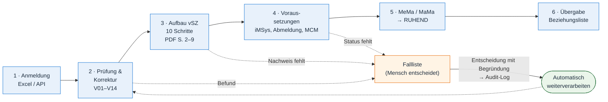
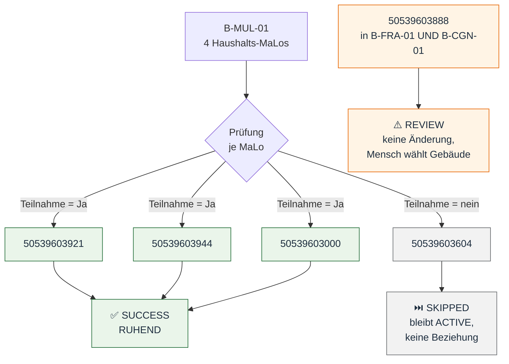
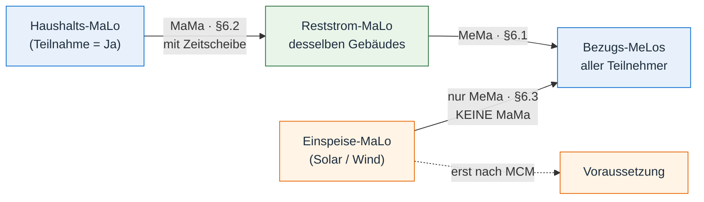

# MK7 Control Center: zwei Kernaussagen des MVP

> **SIMULATION — NO SAP CONNECTION**
> Validierung, Transaktionen und Persistenz (SQLite) laufen real. Die SAP-Antworten sind simuliert.

| | Kernaussage |
|---|---|
| **1** | **Ein Prozess, der automatisch läuft und nur dort anhält, wo ein Mensch entscheiden muss.** |
| **2** | **Fachlich korrekte Umstellung nach Prozessbeschreibung (MeMa / MaMa) mit ehrlicher Simulation.** |

---

## Kernaussage 1: Automatisierung mit gezielter Ausnahmebehandlung

### Der Ablauf in sechs Stufen

**Zum Sagen:** „Ein Befund stoppt nur die betroffene MaLo, nicht den ganzen Lauf. Alle anderen werden weiter umgestellt.“

### Beispiel aus dem echten Datensatz: Gebäude B-MUL-01

| Ergebnis | Bedeutung |
|---|---|
| ✅ `SUCCESS` | Simulierte Umstellung geschrieben **und** nachgelesen. |
| ⏭️ `SKIPPED` | Kein Teilnehmer, keine Änderung. |
| ⚠️ `REVIEW` | Identität mehrdeutig. Das System rät nicht. |
| ⛔ `BLOCKED` | Voraussetzung fehlt, z. B. vSZ nicht fertig. |
| 🔁 `ALREADY_DONE` | Wiederholung erkannt, kein doppelter Eintrag. |

**Zum Sagen:** „Manuell oder als Batch: Beides läuft über dieselbe Engine und liefert dasselbe Ergebnis. Ein zweiter Lauf ist sicher, weil nichts doppelt geschrieben wird.“

---

## Kernaussage 2: Fachlich korrekt und ehrlich

### Beziehungen genau nach Prozessbeschreibung (§6.1–§6.3)

| Gebäude | Reststrom-MaLo (aus Excel abgeleitet, nicht hart codiert) |
|---|---|
| `B-FRA-01` | `51781215544` |
| `B-CGN-01` | `51781215999` |
| `B-MUL-01` | `50539603639` |

Die Zeitscheiben sind halboffen: `[gültig ab, gültig bis)`. Überlappungen werden abgelehnt.

### Was echt ist und was simuliert

```mermaid
flowchart LR
    subgraph REAL["✅ Echt im MVP"]
        direction TB
        A1["Excel-Import<br/>17 Zeilen, 3 Gebäude"]
        A2["Prüfregeln & Engine"]
        A3["SQLite-Persistenz<br/>+ Audit-Log"]
        A4["Tests mit echtem<br/>PASS / FAIL"]
    end
    subgraph SIM["🧪 Simuliert / Annahme"]
        direction TB
        B1["SAP-Antworten"]
        B2["Marktstatus,<br/>vSZ-Bereitschaft"]
        B3["Status: ASSUMED_DEMO<br/>sichtbar markiert"]
    end
    subgraph NO["⛔ Bewusst nicht"]
        direction TB
        C1["Schreiben in SAP IS-U"]
        C2["UTILMD / INVOIC<br/>versenden"]
        C3["SapIsuAdapter =<br/>NOT_CONFIGURED"]
    end
    REAL --> SIM --> NO

    style REAL fill:#eaf5ea,stroke:#256f3a
    style SIM fill:#fff4e5,stroke:#e76500
    style NO fill:#fdecea,stroke:#bb0000
```

**Zum Sagen:** „Wir zeigen nie `SAP_VERIFIED`. Was nicht bewiesen ist, steht als `UNKNOWN` oder `ASSUMED_DEMO` da. Die SAP-Anbindung ist eine klar definierte Schnittstelle. Sie wird erst aktiviert, wenn Zugang, API und Berechtigungen bestätigt sind.“

---

## Abschluss in einem Satz

> **Das MVP stellt die MaLos automatisch, nachvollziehbar und wiederholbar auf ruhend um. Es stoppt nur bei echten Ausnahmen und behauptet nie mehr, als es beweisen kann.**
